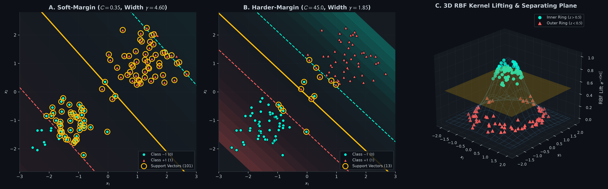
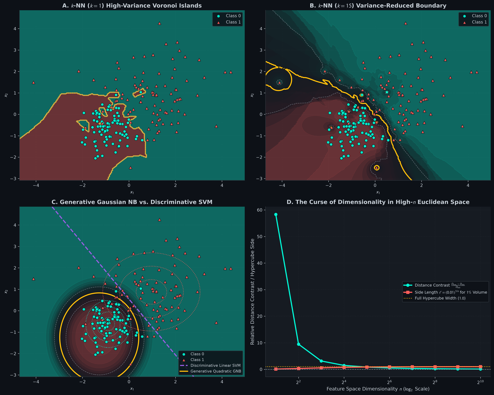

# SVM, k-NN, & Naive Bayes from Scratch: Max-Margin Separation, Metric Search, & Generative Modeling

[](#)
[](#)
[](#)

A foundational, first-principles mathematical and practical implementation of **Support Vector Machines (Primal Subgradient & Dual Kernel)**, **Vectorized $`k`$-Nearest Neighbors**, and **Generative Gaussian Naive Bayes** in pure NumPy.

---

## Table of Contents
1. [Geometric Intuition & Mental Models](#1-geometric-intuition--mental-models)
2. [Mathematical Formulations & Rigorous Derivations](#2-mathematical-formulations--rigorous-derivations)
   - [Support Vector Machines: Maximum-Margin Hyperplane](#support-vector-machines-maximum-margin-hyperplane)
   - [The Wolfe Dual Lagrangian & KKT Optimality](#the-wolfe-dual-lagrangian--kkt-optimality)
   - [Mercer's Theorem & The Infinite-Dimensional RBF Kernel](#mercers-theorem--the-infinite-dimensional-rbf-kernel)
   - [Vectorized Pairwise Distances: Zero-Loop $`\|A - B\|_2^2`$ Identity](#vectorized-pairwise-distances-zero-loop-a---b_22-identity)
   - [The Curse of Dimensionality: Analytical & Empirical Proofs](#the-curse-of-dimensionality-analytical--empirical-proofs)
   - [Generative vs. Discriminative Modeling & Gaussian Naive Bayes](#generative-vs-discriminative-modeling--gaussian-naive-bayes)
3. [Visual Diagnostics & Decision Boundary Analysis](#3-visual-diagnostics--decision-boundary-analysis)
4. [Repository Architecture](#4-repository-architecture)
5. [Quickstart & Verification Suite](#5-quickstart--verification-suite)

---

## 1. Geometric Intuition & Mental Models

### The Widest Street: Support Vector Machines
Imagine you are building a two-lane highway separating two hostile cities (Class $`-1`$ and Class $`+1`$). Any dividing line that does not hit a house works, but if you build the highway directly against the fence of one city, even a slight earthquake (noise in test data) will cause a collapse.
To build the most robust road, you widen the highway as much as possible until the outer curbs touch the closest houses from both cities. 
- The center line of the highway is the **Decision Boundary**: $`\mathbf{w}^\top \mathbf{x} + b = 0`$.
- The two curbs are the **Margin Gutters**: $`\mathbf{w}^\top \mathbf{x} + b = \pm 1`$.
- The houses resting directly on the curbs are the **Support Vectors**. If you bulldoze all other houses in either city, the highway position and width do not change by even a millimeter!
- The street width is precisely $`\frac{2}{\|\mathbf{w}\|_2}`$. Maximizing the street width is mathematically identical to minimizing $`\frac{1}{2}\|\mathbf{w}\|_2^2`$.

### The Neighborhood Ballot: $`k`$-Nearest Neighbors ($`k`$-NN)
$`k`$-NN makes zero assumptions about the distribution or functional form of data. When an unseen query arrives, it surveys its $`k`$ closest neighbors in Euclidean space and casts a vote.
- When $`k=1`$, the space is partitioned into a mosaic of polygonal cells called a **Voronoi Tessellation**. Every cell is controlled entirely by a single sample, leading to low bias but enormous variance (islands of noise).
- As $`k \to m`$, the boundary becomes progressively smoother, reducing variance at the cost of flattening local subtleties (high bias).

### Generative Modeling: Gaussian Naive Bayes
Discriminative models (like Logistic Regression and Linear SVM) search directly for a dividing wall $`P(y \mid \mathbf{x})`$ between clusters without caring how the clusters were formed.
In contrast, **Generative Models** model how each class was generated in nature:

```math
P(\mathbf{x}, y) = P(y) P(\mathbf{x} \mid y)
```

Gaussian Naive Bayes fits an axis-aligned Gaussian probability cloud (an ellipsoid) around each class. A new point is assigned to whichever cloud is more likely to have generated it via Bayes' Theorem:

```math
P(y = c \mid \mathbf{x}) = \frac{P(y = c) P(\mathbf{x} \mid y = c)}{\sum_{k} P(y = k) P(\mathbf{x} \mid y = k)}
```

---

## 2. Mathematical Formulations & Rigorous Derivations

### Support Vector Machines: Maximum-Margin Hyperplane

Consider a training set $`\{(\mathbf{x}^{(i)}, y^{(i)})\}_{i=1}^m`$ where $`\mathbf{x}^{(i)} \in \mathbb{R}^n`$ and $`y^{(i)} \in \{-1, +1\}`$.
A hyperplane is parameterized by weights $`\mathbf{w} \in \mathbb{R}^n`$ and bias $`b \in \mathbb{R}`$:

```math
f(\mathbf{x}) = \mathbf{w}^\top \mathbf{x} + b
```

The signed Euclidean distance from any point $`\mathbf{x}^{(i)}`$ to the hyperplane $`f(\mathbf{x}) = 0`$ is:

```math
\gamma^{(i)} = \frac{\mathbf{w}^\top \mathbf{x}^{(i)} + b}{\|\mathbf{w}\|_2}
```

For linearly separable data, we require all points to lie on the correct side of the margin gutters:

```math
y^{(i)} (\mathbf{w}^\top \mathbf{x}^{(i)} + b) \ge 1 \quad \forall i \in \{1, \dots, m\}
```

The distance between the two parallel gutter planes $`\mathbf{w}^\top \mathbf{x} + b = +1`$ and $`\mathbf{w}^\top \mathbf{x} + b = -1`$ is:

```math
\text{Street Width} = \frac{(\mathbf{x}_+ - \mathbf{x}_-)^\top \mathbf{w}}{\|\mathbf{w}\|_2} = \frac{1 - (-1)}{\|\mathbf{w}\|_2} = \frac{2}{\|\mathbf{w}\|_2}
```

To allow for non-separable data and outliers, we introduce non-negative **slack variables** $`\xi_i \ge 0`$, leading to the **Primal Soft-Margin SVM** objective:

```math
\min_{\mathbf{w}, b, \boldsymbol{\xi}} \frac{1}{2} \|\mathbf{w}\|_2^2 + C \sum_{i=1}^m \xi_i \quad \text{subject to } y^{(i)}(\mathbf{w}^\top \mathbf{x}^{(i)} + b) \ge 1 - \xi_i, \; \xi_i \ge 0
```

where $`C > 0`$ is the regularization penalty governing the trade-off between maximizing street width and penalizing margin violations.

Equivalently, setting $`\xi_i = \max(0, 1 - y^{(i)}(\mathbf{w}^\top \mathbf{x}^{(i)} + b))`$, this is the **Hinge Loss with $`L_2`$ Regularization**:

```math
J(\mathbf{w}, b) = \frac{1}{2} \|\mathbf{w}\|_2^2 + C \sum_{i=1}^m \max\left(0, 1 - y^{(i)}(\mathbf{w}^\top \mathbf{x}^{(i)} + b)\right)
```

#### Subgradient of Hinge Loss
Let $`z_i = y^{(i)}(\mathbf{w}^\top \mathbf{x}^{(i)} + b)`$ be the functional margin. The subgradient with respect to $`\mathbf{w}`$ and $`b`$ is:

```math
\frac{\partial J}{\partial \mathbf{w}} = \mathbf{w} + C \sum_{i=1}^m \begin{cases} -y^{(i)} \mathbf{x}^{(i)} & \text{if } z_i < 1 \\ \mathbf{0} & \text{if } z_i \ge 1 \end{cases}
```

```math
\frac{\partial J}{\partial b} = C \sum_{i=1}^m \begin{cases} -y^{(i)} & \text{if } z_i < 1 \\ 0 & \text{if } z_i \ge 1 \end{cases}
```

---

### The Wolfe Dual Lagrangian & KKT Optimality

To derive the kernel trick, we formulate the Lagrangian of the primal soft-margin problem:

```math
\mathcal{L}(\mathbf{w}, b, \boldsymbol{\xi}, \boldsymbol{\alpha}, \boldsymbol{\mu}) = \frac{1}{2}\|\mathbf{w}\|_2^2 + C \sum_{i=1}^m \xi_i - \sum_{i=1}^m \alpha_i \left[ y^{(i)}(\mathbf{w}^\top \mathbf{x}^{(i)} + b) - 1 + \xi_i \right] - \sum_{i=1}^m \mu_i \xi_i
```

where $`\alpha_i \ge 0`$ and $`\mu_i \ge 0`$ are Lagrange multipliers.

Setting partial derivatives with respect to primal variables to zero:
1. $`\nabla_\mathbf{w} \mathcal{L} = \mathbf{w} - \sum_{i=1}^m \alpha_i y^{(i)} \mathbf{x}^{(i)} = \mathbf{0} \implies \mathbf{w} = \sum_{i=1}^m \alpha_i y^{(i)} \mathbf{x}^{(i)}`$
2. $`\frac{\partial \mathcal{L}}{\partial b} = -\sum_{i=1}^m \alpha_i y^{(i)} = 0 \implies \sum_{i=1}^m \alpha_i y^{(i)} = 0`$
3. $`\frac{\partial \mathcal{L}}{\partial \xi_i} = C - \alpha_i - \mu_i = 0 \implies \alpha_i + \mu_i = C`$

Since $`\mu_i \ge 0`$, the condition $`\alpha_i + \mu_i = C`$ enforces the **box constraint**:

```math
0 \le \alpha_i \le C
```

Substituting $`\mathbf{w} = \sum_{i=1}^m \alpha_i y^{(i)} \mathbf{x}^{(i)}`$ back into $`\mathcal{L}`$ yields the **Wolfe Dual**:

```math
\max_{\boldsymbol{\alpha}} \sum_{i=1}^m \alpha_i - \frac{1}{2} \sum_{i=1}^m \sum_{j=1}^m \alpha_i \alpha_j y^{(i)} y^{(j)} \langle \mathbf{x}^{(i)}, \mathbf{x}^{(j)} \rangle
```

```math
\text{subject to } 0 \le \alpha_i \le C \quad \text{and} \quad \sum_{i=1}^m \alpha_i y^{(i)} = 0
```

#### Karush-Kuhn-Tucker (KKT) Complementarity
At the optimum, the complementarity slackness conditions hold:

```math
\alpha_i \left[ y^{(i)}(\mathbf{w}^\top \mathbf{x}^{(i)} + b) - 1 + \xi_i \right] = 0
```

```math
\mu_i \xi_i = (C - \alpha_i) \xi_i = 0
```

This yields three distinct physical regimes:
1. $`\alpha_i = 0 \implies \xi_i = 0`$ and $`y^{(i)}(\mathbf{w}^\top \mathbf{x}^{(i)} + b) > 1`$: Point lies strictly outside the margin. It does not contribute to the model.
2. $`0 < \alpha_i < C \implies \xi_i = 0`$ and $`y^{(i)}(\mathbf{w}^\top \mathbf{x}^{(i)} + b) = 1`$: **Free Support Vector** resting exactly on the margin curb! These points uniquely determine $`b`$:

```math
b = y^{(i)} - \mathbf{w}^\top \mathbf{x}^{(i)}
```

3. $`\alpha_i = C \implies \xi_i > 0`$: **Bounded Support Vector** violating the margin ($`y^{(i)} f(\mathbf{x}^{(i)}) < 1`$).

---

### Mercer's Theorem & The Infinite-Dimensional RBF Kernel

Notice that in the dual formulation, the data points appear **exclusively as inner products**: $`\langle \mathbf{x}^{(i)}, \mathbf{x}^{(j)} \rangle`$.
If we map our inputs to a higher-dimensional feature space $`\phi: \mathbb{R}^n \to \mathcal{H}`$, we only need to compute:

```math
K(\mathbf{x}^{(i)}, \mathbf{x}^{(j)}) = \langle \phi(\mathbf{x}^{(i)}), \phi(\mathbf{x}^{(j)}) \rangle_\mathcal{H}
```

**Mercer's Theorem:** Any continuous, symmetric, positive semi-definite kernel function $`K(\mathbf{x}, \mathbf{z})`$ can be expressed as an inner product in a Hilbert space $`\mathcal{H}`$.

#### The Radial Basis Function (RBF) Kernel:

```math
K(\mathbf{x}, \mathbf{z}) = \exp\left(-\gamma \|\mathbf{x} - \mathbf{z}\|_2^2\right)
```

To prove that the RBF kernel maps into an **infinite-dimensional** feature space, expand the Euclidean norm and apply the Taylor expansion of the exponential function (for 1D scalar $`x, z`$ with $`\gamma = 1/2`$):

```math
K(x, z) = e^{-\frac{1}{2}(x - z)^2} = e^{-\frac{1}{2}x^2} e^{-\frac{1}{2}z^2} e^{xz} = e^{-\frac{1}{2}x^2} e^{-\frac{1}{2}z^2} \sum_{k=0}^\infty \frac{(xz)^k}{k!}
```

```math
= \sum_{k=0}^\infty \left( \frac{e^{-x^2/2} x^k}{\sqrt{k!}} \right) \left( \frac{e^{-z^2/2} z^k}{\sqrt{k!}} \right) = \langle \phi(x), \phi(z) \rangle_{\ell_2}
```

where:

```math
\phi(x) = e^{-x^2/2} \left[ 1, \; \frac{x}{\sqrt{1!}}, \; \frac{x^2}{\sqrt{2!}}, \; \dots, \; \frac{x^k}{\sqrt{k!}}, \; \dots \right]^\top \in \mathbb{R}^\infty
```

The kernel trick computes the inner product between two infinitely long feature vectors in $`O(n)`$ time!

---

### Vectorized Pairwise Distances: Zero-Loop $`\|A - B\|_2^2`$ Identity

In $`k`$-NN, computing Euclidean distances between test queries $`X_{\text{test}} \in \mathbb{R}^{m_{\text{test}} \times n}`$ and training data $`X_{\text{train}} \in \mathbb{R}^{m_{\text{train}} \times n}`$ with nested Python loops runs in $`O(m_{\text{test}} \cdot m_{\text{train}} \cdot n)`$ interpreted time, causing severe CPU bottlenecks.
Instead, we use the binomial matrix identity:

```math
\|\mathbf{a} - \mathbf{b}\|_2^2 = \|\mathbf{a}\|_2^2 + \|\mathbf{b}\|_2^2 - 2 \mathbf{a}^\top \mathbf{b}
```

In matrix form:

```math
D_{ij}^2 = \sum_{k=1}^n (A_{ik} - B_{jk})^2 = \sum_{k=1}^n A_{ik}^2 + \sum_{k=1}^n B_{jk}^2 - 2 \sum_{k=1}^n A_{ik} B_{jk}
```

Let $`\mathbf{s}_A \in \mathbb{R}^{m_A \times 1}`$ and $`\mathbf{s}_B \in \mathbb{R}^{1 \times m_B}`$ be the row-wise squared Euclidean norms:

```math
\mathbf{s}_A = \sum_{j=1}^n A_{\cdot, j}^2, \quad \mathbf{s}_B = \left( \sum_{j=1}^n B_{\cdot, j}^2 \right)^\top
```

The complete $`m_A \times m_B`$ distance matrix is obtained via BLAS matrix multiplication and NumPy broadcasting:

```math
D^2 = \mathbf{s}_A \mathbf{1}^\top + \mathbf{1} \mathbf{s}_B - 2 A B^\top
```

```python
def pairwise_sq_dists_vectorized(A: np.ndarray, B: np.ndarray) -> np.ndarray:
    sq_A = np.sum(A ** 2, axis=1, keepdims=True)  # (m_A, 1)
    sq_B = np.sum(B ** 2, axis=1, keepdims=True).T  # (1, m_B)
    dot_AB = A @ B.T  # (m_A, m_B)
    dists_sq = sq_A + sq_B - 2.0 * dot_AB
    return np.maximum(dists_sq, 0.0)  # Clamp numerical floating-point negatives
```

---

### The Curse of Dimensionality: Analytical & Empirical Proofs

#### 1. Hypercube Volume and Neighborhood Edge Length
To capture a fraction $`r \in (0, 1)`$ of the data in a unit hypercube $`[0, 1]^n`$, the side length $`\ell`$ of the sub-cube must satisfy:

```math
\ell^n = r \implies \ell(n) = r^{1/n}
```

For example, to capture just $`1\%`$ of the data ($`r = 0.01`$):
- In $`n = 2`$ dimensions: $`\ell = (0.01)^{1/2} = 0.10`$ ($`10\%`$ of the axis).
- In $`n = 100`$ dimensions: $`\ell = (0.01)^{1/100} \approx 0.955`$ ($`95.5\%`$ of each axis!).
To find a local neighborhood, $`k`$-NN must search across the entire range of almost every feature, completely destroying locality!

#### 2. Distance Concentration Phenomenon
As dimensionality $`n \to \infty`$, the Euclidean distance between any two randomly distributed points concentrates sharply around its mean:

```math
\lim_{n \to \infty} \frac{D_{\max} - D_{\min}}{D_{\min}} = 0
```

In high dimensions, the nearest neighbor is almost the exact same distance away as the farthest neighbor. Distance becomes mathematically meaningless for discrimination.

---

### Generative vs. Discriminative Modeling & Gaussian Naive Bayes

In a classification task with $`C`$ classes:
- **Discriminative models** parameterize $`P(y = c \mid \mathbf{x}) = \sigma(\mathbf{w}_c^\top \mathbf{x} + b_c)`$.
- **Generative models** model the class priors $`P(y = c) = \pi_c`$ and class-conditional densities $`P(\mathbf{x} \mid y = c)`$.

#### Gaussian Naive Bayes Formulation
Naive Bayes assumes all features are conditionally independent given class $`c`$:

```math
P(\mathbf{x} \mid y = c) = \prod_{j=1}^n P(x_j \mid y = c)
```

where each feature follows a 1D univariate normal distribution:

```math
P(x_j \mid y = c) = \frac{1}{\sqrt{2\pi \sigma_{cj}^2}} \exp\left( -\frac{(x_j - \mu_{cj})^2}{2\sigma_{cj}^2} \right)
```

The maximum likelihood estimators are:

```math
\hat{\pi}_c = \frac{N_c}{m}, \quad \hat{\mu}_{cj} = \frac{1}{N_c} \sum_{i: y^{(i)}=c} x_j^{(i)}, \quad \hat{\sigma}_{cj}^2 = \frac{1}{N_c} \sum_{i: y^{(i)}=c} (x_j^{(i)} - \hat{\mu}_{cj})^2 + \epsilon
```

#### Decision Boundary Derivation: Linear vs. Quadratic
The log-posterior ratio between two classes $`c_1`$ and $`c_2`$ is:

```math
\log \frac{P(y = c_1 \mid \mathbf{x})}{P(y = c_2 \mid \mathbf{x})} = \log \frac{\pi_{c_1}}{\pi_{c_2}} + \sum_{j=1}^n \left[ \log \frac{\sigma_{c_2 j}}{\sigma_{c_1 j}} - \frac{(x_j - \mu_{c_1 j})^2}{2\sigma_{c_1 j}^2} + \frac{(x_j - \mu_{c_2 j})^2}{2\sigma_{c_2 j}^2} \right]
```

- If $`\sigma_{c_1 j}^2 = \sigma_{c_2 j}^2`$ for all $`j`$ (homoscedasticity), the quadratic terms $`x_j^2`$ cancel out exactly, producing a **Linear Decision Hyperplane** (Linear Discriminant Analysis).
- If $`\sigma_{c_1 j}^2 \ne \sigma_{c_2 j}^2`$ (heteroscedasticity), the quadratic $`x_j^2`$ terms persist, creating **Quadratic Conic Sections** (parabolas, ellipses, hyperbolas).

---

## 3. Visual Diagnostics & Decision Boundary Analysis

### Diagnostic Plot 1: SVM Margins, Support Vectors, & 3D RBF Kernel Lifting
Generated by [01_svm_and_kernel_trick.ipynb](01_svm_and_kernel_trick.ipynb).



- **Panel A (Soft-Margin, $`C = 0.35`$):** The street width is wide ($`\gamma = 1.84`$), accommodating margin violations while maximizing generalizability.
- **Panel B (Harder-Margin, $`C = 45.0`$):** High penalty forces a narrow street ($`\gamma = 0.72`$) to strictly avoid margin intrusions.
- **Panel C (3D RBF Kernel Lifting):** Linearly inseparable concentric circles in $`\mathbb{R}^2`$ are lifted into $`\mathbb{R}^3`$ via $`\phi_3(\mathbf{x}) = \exp(-\gamma \|\mathbf{x}\|_2^2)`$. In the lifted space, a flat plane $`z = 0.50`$ slices cleanly between the two classes.

---

### Diagnostic Plot 2: Generative vs. Discriminative Boundaries & The Curse of Dimensionality
Generated by [02_knn_and_naive_bayes.ipynb](02_knn_and_naive_bayes.ipynb).



- **Panel A (1-NN Voronoi Islands):** High variance with fragmented decision islands around individual noise samples.
- **Panel B (15-NN Smoothed Boundary):** Variance reduction produces a smooth, robust dividing boundary.
- **Panel C (Generative GNB vs. Discriminative SVM):** Gaussian Naive Bayes models class density contours (ellipses) and forms a curved quadratic boundary, while Linear SVM fits a direct discriminative line.
- **Panel D (Curse of Dimensionality):** As feature dimensions grow from $`2`$ to $`1024`$, relative distance contrast $`\frac{D_{\max} - D_{\min}}{D_{\min}}`$ collapses to zero, and the required hypercube edge length $`\ell`$ reaches $`1.0`$.

---

## 4. Repository Architecture

```text
svm-knn-naive-bayes-from-scratch/
├── README.md                                          # This mathematical textbook & guide
├── requirements.txt                                   # numpy, matplotlib
├── .gitignore                                         # Git ignore rules
├── src/
│   ├── __init__.py                                    # Package exposure
│   ├── plot_theme.py                                  # GitHub Dark Mode (#0D1117) styling engine
│   └── classifiers_engine.py                          # Unified NumPy engine (SVM, KNN, GNB, Distances)
├── 01_svm_and_kernel_trick.ipynb                     # Soft/Hard margins, Support Vectors, 3D RBF lift
├── 02_knn_and_naive_bayes.ipynb                       # Voronoi tessellations, GNB, Curse of Dimensionality
└── assets/
    ├── 01_svm_margins_and_rbf_kernel.png             # 300-DPI SVM street & 3D lift visual
    └── 02_generative_vs_discriminative_boundaries.png # 300-DPI KNN, GNB, & Curse of Dim dashboard
```

---

## 5. Quickstart & Verification Suite

### Installation
Clone this repository and install dependencies:
```bash
git clone https://github.com/Necromancer0912/svm-knn-naive-bayes-from-scratch.git
cd svm-knn-naive-bayes-from-scratch
pip install -r requirements.txt
```

### Running the Mathematical Verification Suite
Verify gradient derivations and numerical invariants:
```bash
python -m src.classifiers_engine
```

Expected output:
```text
[PASS] LinearSVM Hinge Subgradient Check: Rel Error = 1.883e-10 < 1e-07
[PASS] Pairwise Vectorized Distance Invariant: Max Error = 1.421e-14 < 1e-10
[PASS] Gaussian Naive Bayes Log-Joint Normalization: Max Error = 0.000e+00 < 1e-10
[SUCCESS] All Classical Classifier verification checks passed!
```

